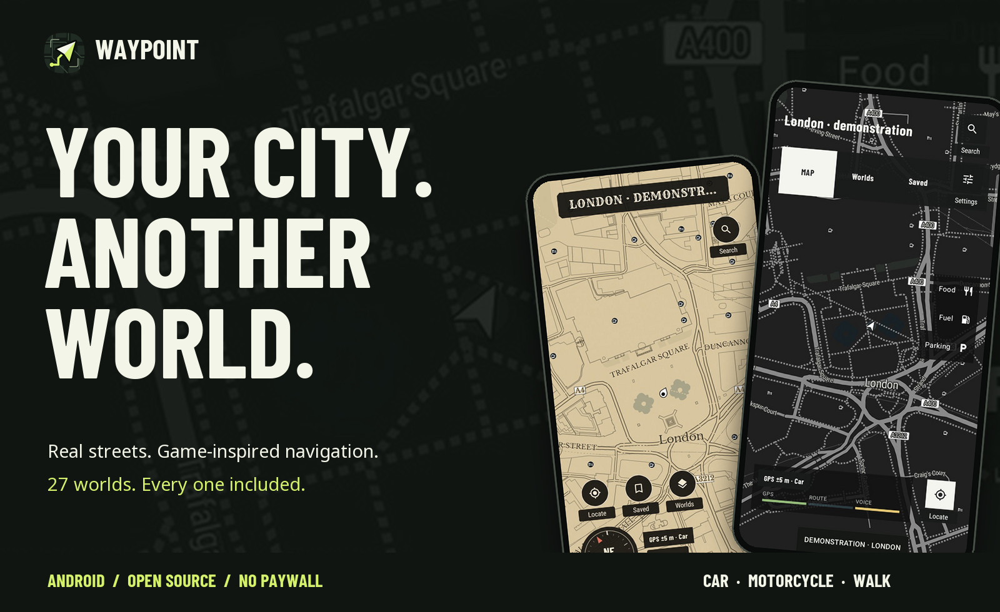
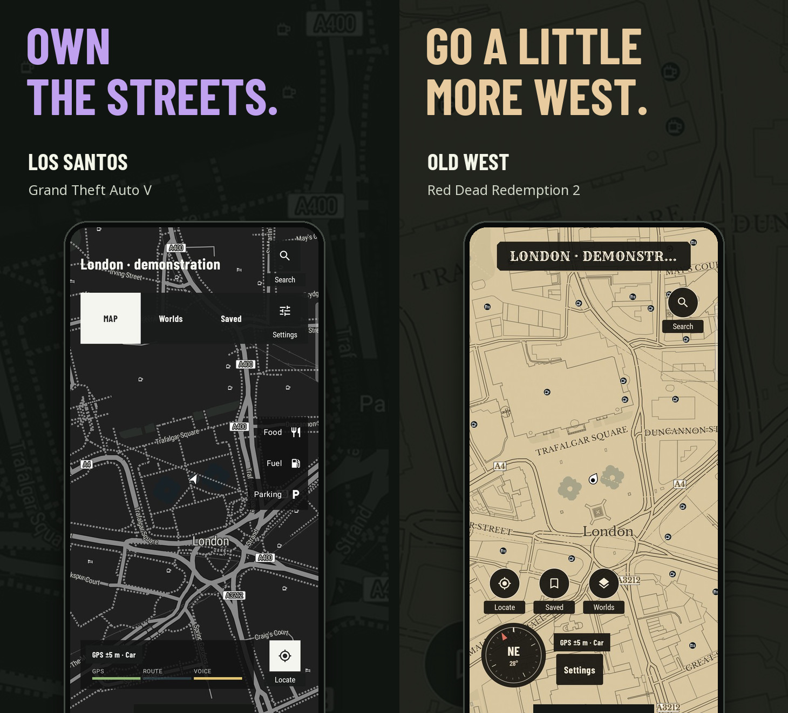
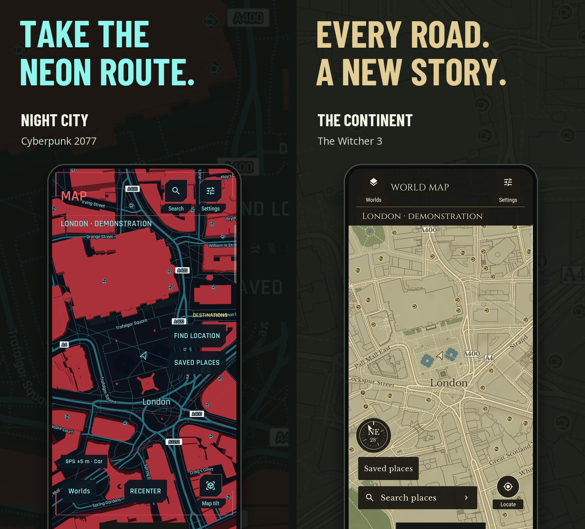
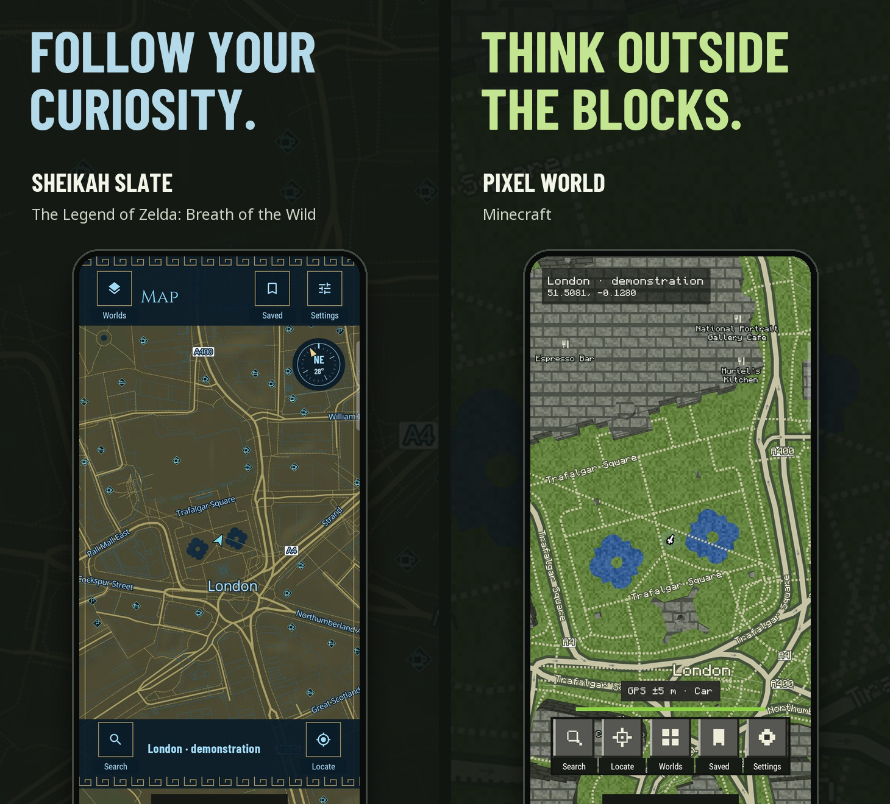
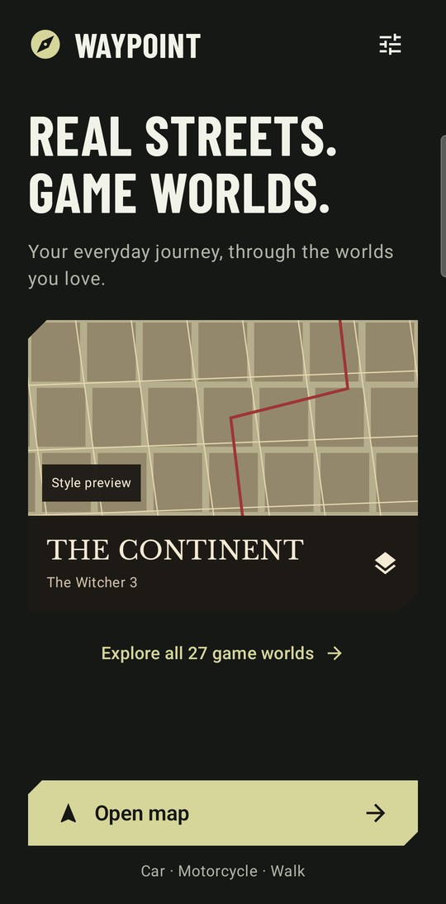
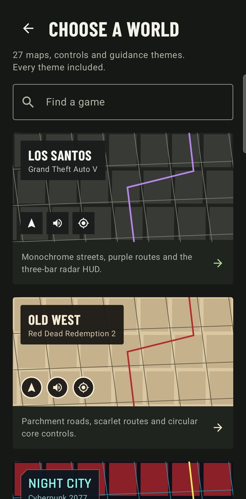

<div align="center">
  <picture>
    <source media="(max-width: 640px)" srcset="docs/images/promo/hero-mobile.jpg" />
    
  </picture>
  <p><strong>Your everyday journey, through the worlds you love.</strong><br />Native Android navigation. Real GPS. Spoken directions. A whole different atmosphere.</p>
  <a href="https://github.com/the-geeky-couldron/waypoint/releases/latest"></a>
  <p><sub>Android 8.0+ · Free APK · No account · No ads · Every world unlocked</sub></p>
  <p>
    <a href="https://github.com/the-geeky-couldron/waypoint/releases/latest"></a>
    <a href="https://github.com/the-geeky-couldron/waypoint/actions/workflows/android.yml"></a>
    <a href="LICENSE"></a>
  </p>
  <p><a href="#choose-your-world">Explore the worlds</a> · <a href="#built-for-the-journey">Navigation</a> · <a href="#get-waypoint">Install</a> · <a href="#build-it-yourself">Build from source</a></p>
</div>

## Choose your world

A charcoal city grid. A weathered frontier atlas. Neon streets after dark. **Waypoint puts 27 game-inspired map styles over the real world**, each with its own roads, lettering, pointer and controls. Switch worlds during a trip and keep your destination.

<picture>
  <source media="(max-width: 640px)" srcset="docs/images/promo/worlds-1-mobile.jpg" />
  
</picture>

<picture>
  <source media="(max-width: 640px)" srcset="docs/images/promo/worlds-2-mobile.jpg" />
  
</picture>

<picture>
  <source media="(max-width: 640px)" srcset="docs/images/promo/worlds-3-mobile.jpg" />
  
</picture>

<sub>Actual native app captures at a fixed London demonstration position, composed into original promotional artwork. The maps show real geography with game-inspired styling. Full captures: <a href="docs/images/los-santos.jpg">Los Santos</a> · <a href="docs/images/old-west.jpg">Old West</a> · <a href="docs/images/night-city.jpg">Night City</a> · <a href="docs/images/rivia.jpg">The Continent</a> · <a href="docs/images/hyrule.jpg">Sheikah Slate</a> · <a href="docs/images/pixel.jpg">Pixel World</a>.</sub>

<details>
<summary><strong>Six shown. Twenty-seven to explore. See the full world library →</strong></summary>

| World | Inspiration |
| :--- | :--- |
| Los Santos | Grand Theft Auto V |
| Old West | Red Dead Redemption 2 |
| Night City | Cyberpunk 2077 |
| Pixel World | Minecraft |
| Green Terminal | Fallout |
| San Andreas | Grand Theft Auto: San Andreas |
| Midnight Run | Need for Speed Heat |
| The Continent | The Witcher 3 |
| Vice Coast | Grand Theft Auto: Vice City |
| Liberty City | Grand Theft Auto IV |
| Nudle Maps | Watch Dogs 2 |
| Sheikah Slate | The Legend of Zelda: Breath of the Wild |
| Skyrim | The Elder Scrolls V: Skyrim |
| Lands Between | Elden Ring |
| Horizon | Forza Horizon |
| Animus | Assassin’s Creed Origins |
| Hope County | Far Cry 5 |
| Tsushima | Ghost of Tsushima |
| Bridges | Death Stranding |
| The Embrace | Horizon Zero Dawn |
| Manhattan | Marvel’s Spider-Man |
| Highlands | Hogwarts Legacy |
| Surface Map | Starfield |
| Bohemia | Kingdom Come: Deliverance II |
| Steelport | Saints Row: The Third |
| Medici | Just Cause 3 |
| Lost Heaven | Mafia: Definitive Edition |


</details>

## Built for the journey

**Drive. Ride. Walk.** Choose a car, motorcycle or walking route. Get spoken turns, remaining distance and arrival estimates, with controls that tell you what they do.

**Stay at the centre.** Your pointer stays centred while the map follows your movement. The travelled route clears behind you. Take another road and Waypoint requests a new route once accurate GPS fixes confirm you are off course.

**Find the place you meant.** Typo-tolerant matching and the Android geocoder supplement Photon search. Results show mapped names, addresses and providers, so you can check the destination before setting off.

**Make it yours.** Save favourite places, choose miles or kilometres, mute guidance, and change worlds without ending the trip. Every map style is included from the start.

<p align="center"><strong>Car · Motorcycle · Walk</strong><br /><sub>Live location · Sensor-assisted heading · Spoken turns · Automatic rerouting</sub></p>

## At home on your home screen


An original adaptive icon that fits your launcher’s shape. **Material You themed icons** match your wallpaper on Android 13+ with a compatible launcher and themed icons enabled. Inside the app, each game world keeps its own palette.

## Get Waypoint

**[Download the latest Waypoint.apk →](https://github.com/the-geeky-couldron/waypoint/releases/latest)**

1. Download **Waypoint.apk** and open it. Follow Android’s installation prompts.
2. Choose a world, tap **Open map**, then **Locate** and grant precise location.
3. Search for a place or hold the map to drop a pin. Choose **Car**, **Motorcycle** or **Walk** and tap **Start navigation**.

**Already installed?** Go to **Settings → App updates → Check for updates**. Waypoint checks the downloaded APK’s checksum, package, version and signing identity before opening Android’s installer. You choose when to install; compatible updates preserve your saved places and preferences. End navigation before installing.

<details>
<summary><strong>A look inside: welcome screen and world library</strong></summary>

<p align="center">
  
  
</p>

</details>

## Open source, from map to APK

Built with **Kotlin · Jetpack Compose · MapLibre Native**. The code is MIT licensed, the releases are built with GitHub Actions, and the app downloads updates directly from public GitHub Releases. No GitHub account or token is needed in the app.

### Build it yourself

Use **JDK 17**, Android **SDK 35** and **Build Tools 35.0.0**. The Gradle wrapper is included.

```sh
git clone https://github.com/the-geeky-couldron/waypoint.git
cd waypoint
# Set ANDROID_HOME, or add sdk.dir=/your/android-sdk to local.properties.
./gradlew :app:assembleDebug :app:testDebugUnitTest :app:lintDebug
adb install -r app/build/outputs/apk/debug/app-debug.apk
```

No map API key is required for the included evaluation services. Local debug builds use your own signing key and may not install over a downloaded release. Keep a consistent signing identity for upgrades.

<details>
<summary><strong>Build pipeline, releases and artwork</strong></summary>

GitHub Actions builds the app, runs unit tests and lint, and validates all 27 map styles on pushes and pull requests. Debug APKs and reports are saved as workflow artifacts.

A version tag such as `v0.2.3` runs the checks again, builds a signed release and publishes **Waypoint.apk** and **SHA256SUMS**. The in-app updater reads that release. Versions live in [`version.properties`](version.properties); signing and publishing are covered in the [release guide](docs/releasing.md).

The promotional posters are reproducible with `python3 scripts/create_readme_promo.py` using Pillow, the repository’s licensed fonts, and sanitised app screenshots. The posters contain no original game artwork. See [the artwork notes](docs/images/promo/README.md).

</details>

## Know before you go

Waypoint is an independent hobby project. Maps and routes need an internet connection; public services can be rate-limited. There is **no live traffic, lane guidance or offline routing**. Android Auto is disabled in this release. Controlled device tests cover location movement, route replacement and camera following; real-road and battery-endurance validation remain outstanding. See [what has been tested](docs/validation.md).

Search coverage depends on the available providers and does not match Google Maps’ full place database. An address match is labelled as an address match, so it is distinguishable from a named landmark.

<details>
<summary><strong>Privacy, map providers and security</strong></summary>

Maps use OpenStreetMap data through OpenFreeMap. Search combines Photon with Android’s device geocoder when available. Car routing uses OSRM; motorcycle and walking use Valhalla. Terrain uses Mapzen data. Provider credits remain accessible through **Map info**.

Location and destinations are sent to mapping, search and routing providers when needed. Android’s geocoder provider and coverage vary by device. Saved places stay on the device. There is no app-owned account system, analytics server or recorded location history. Update checks contact GitHub without location data; downloads run only when requested and can be cancelled. Read the [privacy and service notes](docs/guide.md#location-and-privacy).

The hardening work includes strict destination-link parsing, cancellation of obsolete requests, bounded responses, validated route geometry and verified update packages. A security review cannot guarantee invulnerability. See the [security review](docs/security.md) or [report a concern](SECURITY.md).

</details>

## Explore the project

| Start here | What you’ll find |
| :--- | :--- |
| [App & development guide](docs/guide.md) | Setup, architecture, services and transport profiles |
| [Release guide](docs/releasing.md) | Actions, signing and in-app updates |
| [Visual sourcebook](docs/visual-sourcebook.md) | Game references and cartography decisions |
| [Map typography](docs/map-fonts.md) | Fonts, glyphs and fidelity limits |
| [Sensors](docs/sensors.md) | Compass, GPS course and accuracy handling |
| [Validation](docs/validation.md) | Completed checks and remaining hardware work |
| [Security](docs/security.md) | Boundaries, fixes and validation limits |

Contributions are welcome. Read the [contribution and privacy guidelines](CONTRIBUTING.md), include relevant tests, and keep real roads and guidance legible when adding a world.

---

<div align="center">
  
  <h3>Every world included. Every journey your own.</h3>
  <p><a href="https://github.com/the-geeky-couldron/waypoint/releases/latest"><strong>Get Waypoint →</strong></a></p>
  <sub>Independent, game-inspired navigation. Not affiliated with any game or publisher.<br />Original graphics and licensed open fonts. Code: <a href="LICENSE">MIT</a> · <a href="docs/licenses">Third-party licenses</a></sub>
</div>
