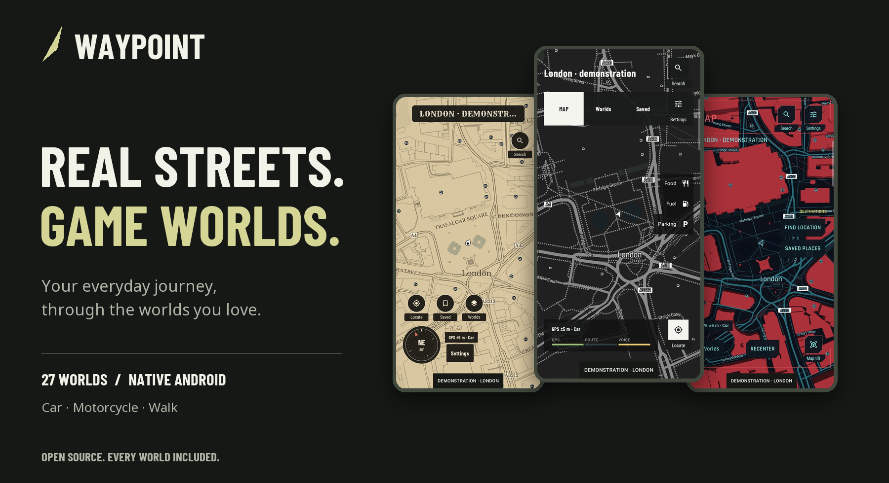
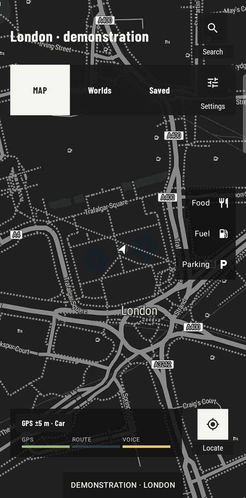
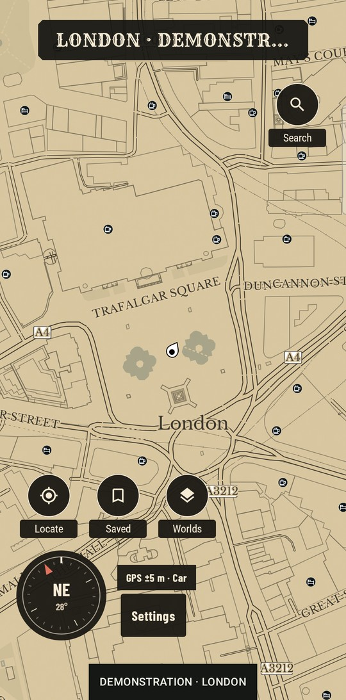
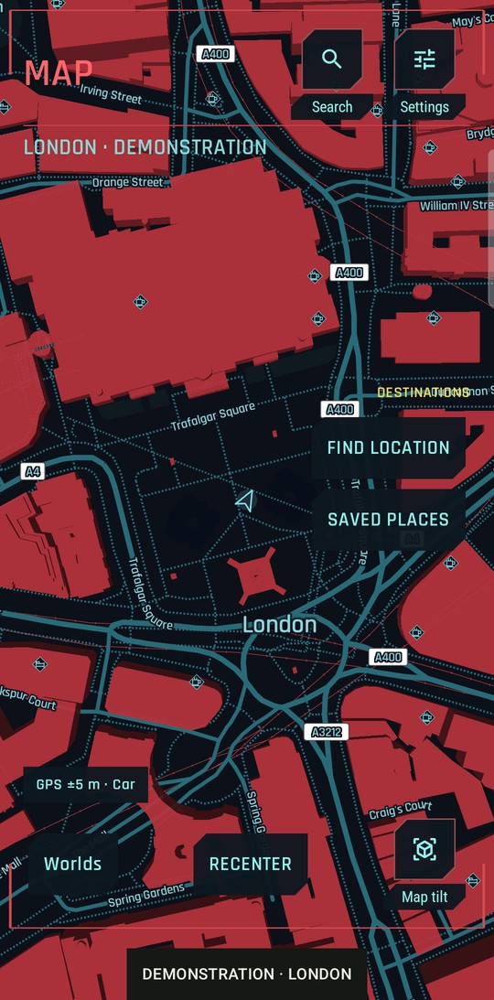
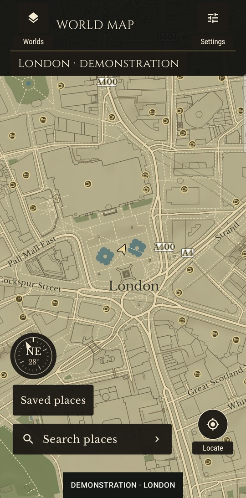
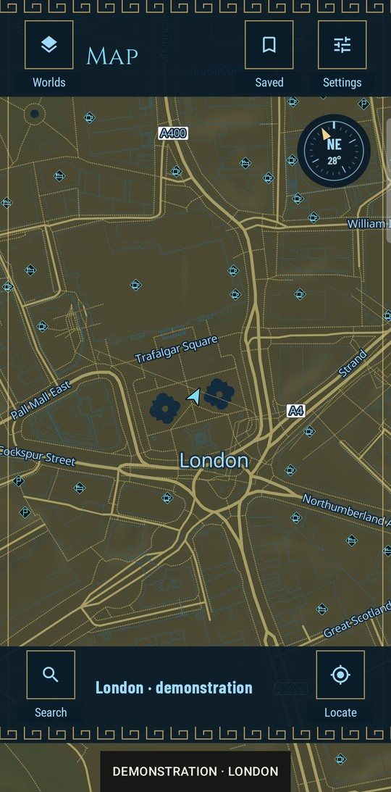
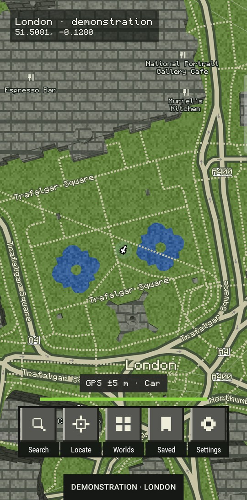
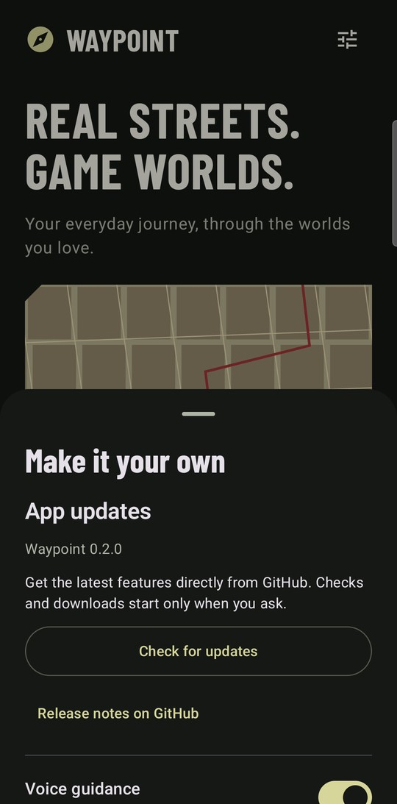

<div align="center">
  
  <p><strong>Your everyday journey, through the worlds you love.</strong></p>
  <p>Real GPS navigation. Distinct game-inspired maps. Every world included.</p>
  <p>
    <a href="https://github.com/the-geeky-couldron/waypoint/releases/latest"></a>
    <a href="https://github.com/the-geeky-couldron/waypoint/actions/workflows/android.yml"></a>
    <a href="LICENSE"></a>
  </p>
  <p><a href="#get-waypoint">Get Waypoint</a> · <a href="#choose-your-world">Explore the worlds</a> · <a href="#build-it-yourself">Build from source</a> · <a href="docs/releasing.md">Release guide</a></p>
</div>

## The road is real. The atmosphere is yours.

Turn a familiar commute into a different kind of journey. Waypoint pairs real streets, destinations and turn-by-turn directions with the visual language of open-world games: charcoal city grids, weathered frontier maps, neon streets, fantasy atlases and pixel landscapes.

Built natively for Android with **Kotlin, Jetpack Compose and MapLibre Native**. No account to create. No ads, subscriptions or locked themes.

<table>
  <tr>
    <td width="33%"><strong>Navigate your way</strong><br />Car, motorcycle and walking profiles. Spoken turns, route progress, estimated arrival and off-route recalculation.</td>
    <td width="33%"><strong>Change the atmosphere</strong><br />Switch between 27 worlds during a route. Your destination and transport mode stay with you.</td>
    <td width="33%"><strong>Make it yours</strong><br />Save places, choose miles or kilometres, toggle voice and perspective, and update directly from the app.</td>
  </tr>
</table>

## Choose your world

Distinct typography, road treatments, palettes, pointers and control layouts. Familiar inspiration, real-world geography.

<table>
  <tr>
    <td align="center"><br /><strong>LOS SANTOS</strong><br /><sub>Grand Theft Auto V</sub></td>
    <td align="center"><br /><strong>OLD WEST</strong><br /><sub>Red Dead Redemption 2</sub></td>
    <td align="center"><br /><strong>NIGHT CITY</strong><br /><sub>Cyberpunk 2077</sub></td>
  </tr>
  <tr>
    <td align="center"><br /><strong>THE CONTINENT</strong><br /><sub>The Witcher 3</sub></td>
    <td align="center"><br /><strong>SHEIKAH SLATE</strong><br /><sub>The Legend of Zelda: Breath of the Wild</sub></td>
    <td align="center"><br /><strong>PIXEL WORLD</strong><br /><sub>Minecraft</sub></td>
  </tr>
</table>

*Captured from the native app using a fixed London demonstration position. These are game-inspired styles over real map data, not screenshots or assets from the original games.*

<details>
<summary><strong>See all 27 worlds</strong></summary>

| World | Inspiration |
| :--- | :--- |
| Los Santos | Grand Theft Auto V |
| Old West | Red Dead Redemption 2 |
| Night City | Cyberpunk 2077 |
| Pixel World | Minecraft |
| Green Terminal | Fallout |
| San Andreas | Grand Theft Auto: San Andreas |
| Midnight Run | Need for Speed Heat |
| The Continent | The Witcher 3 |
| Vice Coast | Grand Theft Auto: Vice City |
| Liberty City | Grand Theft Auto IV |
| Nudle Maps | Watch Dogs 2 |
| Sheikah Slate | The Legend of Zelda: Breath of the Wild |
| Skyrim | The Elder Scrolls V: Skyrim |
| Lands Between | Elden Ring |
| Horizon | Forza Horizon |
| Animus | Assassin’s Creed Origins |
| Hope County | Far Cry 5 |
| Tsushima | Ghost of Tsushima |
| Bridges | Death Stranding |
| The Embrace | Horizon Zero Dawn |
| Manhattan | Marvel’s Spider-Man |
| Highlands | Hogwarts Legacy |
| Surface Map | Starfield |
| Bohemia | Kingdom Come: Deliverance II |
| Steelport | Saints Row: The Third |
| Medici | Just Cause 3 |
| Lost Heaven | Mafia: Definitive Edition |

</details>

## From welcome screen to your next turn

<table>
  <tr>
    <td align="center"><br /><strong>A world before a route</strong><br />Pick your atmosphere, then open the map.</td>
    <td align="center"><br /><strong>Find your favourite</strong><br />Search the library by game or map style.</td>
    <td align="center"><br /><strong>Keep moving forward</strong><br />Download verified updates from Settings.</td>
  </tr>
</table>

## Get Waypoint

**[Download the latest Android APK →](https://github.com/the-geeky-couldron/waypoint/releases/latest)**

1. Download **Waypoint.apk** from the latest release. Requires **Android 8.0 or newer**.
2. Open it and follow Android’s installation prompts.
3. Choose a world, tap **Open map**, then **Locate** and grant precise location.
4. Search for a destination or hold the map to drop a pin. Choose **Car**, **Motorcycle** or **Walk**, then **Start navigation**.

**Already installed?** Open **Settings → App updates → Check for updates**. The app downloads the stable GitHub release, checks its SHA-256 checksum and signing identity, then opens Android’s installer. Installation is always your choice; saved places and preferences are preserved when updating a compatible build. End active navigation before installing.

Updates do not need a GitHub account. No GitHub token is stored in the app. Downloads happen only when requested and can be cancelled.

## Built for the phone in your hand

- **Sensor-assisted heading:** rotation-vector compass at rest, usable GPS course in motion, true-north correction and accuracy-aware fallback.
- **Readable controls:** visible action labels, large touch targets, safe-area spacing and large-text/landscape support.
- **Native performance:** cached previews, stable list items and paused map rendering behind covered screens.
- **Continuity:** foreground-service guidance, saved destinations, and `geo:` / `google.navigation:` links.
- **Experimental Android Auto:** projected navigation screens share the phone’s route engine. Head-unit validation is still pending.

## Build it yourself

Use **JDK 17**, Android **SDK 35**, and **Build Tools 35.0.0**. The Gradle wrapper is included.

```sh
git clone https://github.com/the-geeky-couldron/waypoint.git
cd waypoint
# Set ANDROID_HOME, or add sdk.dir=/your/android-sdk to local.properties.
./gradlew :app:assembleDebug :app:testDebugUnitTest :app:lintDebug
adb install -r app/build/outputs/apk/debug/app-debug.apk
```

No map API key is required for the included evaluation services. Local debug builds use your own signing key and may not install over a downloaded release. Keep a consistent signing identity for upgrades.

### Automated builds and releases

GitHub Actions builds the Android app, runs unit tests and lint, and validates all 27 map styles on pushes and pull requests. Debug APKs and reports are available as workflow artifacts.

Pushing a version tag such as `v0.2.0` runs the checks again, builds a signed release with encrypted signing secrets, and publishes **Waypoint.apk** and **SHA256SUMS**. The in-app updater reads that release. Versions live in [`version.properties`](version.properties).

See **[the release guide](docs/releasing.md)** for signing setup, versioning and the exact release commands.

## Open code. Clear boundaries.

Waypoint is an independent hobby project, with original game-inspired map styles and licensed open fonts. It is not affiliated with the games or their publishers, and contains no proprietary game art, logos or fonts.

Maps use OpenStreetMap data through OpenFreeMap. Search uses Photon; car routing uses OSRM; motorcycle and walking use Valhalla. Terrain uses Mapzen data. Provider credits remain accessible from the map.

Location and destinations are sent to mapping, search and routing providers when needed. Saved places stay on the device. There is no app-owned account system, analytics server or recorded location history. Update checks contact GitHub and do not include location. See the [privacy and service notes](docs/guide.md#location-and-privacy).

**Current limits:** online maps and routing are required. Public services can be throttled. There is no live traffic, lane guidance or offline routing. Real-road navigation, battery endurance and Android Auto head-unit validation remain outstanding. See [what has actually been tested](docs/validation.md).

## Explore the project

| Guide | What’s inside |
| :--- | :--- |
| [App and development guide](docs/guide.md) | Setup, architecture, services and transport profiles |
| [Release guide](docs/releasing.md) | Actions, signing and in-app updates |
| [Visual sourcebook](docs/visual-sourcebook.md) | Reference research and cartography decisions |
| [Map typography](docs/map-fonts.md) | Fonts, glyphs and fidelity limits |
| [Sensors](docs/sensors.md) | Compass, GPS course and accuracy handling |
| [Validation](docs/validation.md) | Completed checks and remaining hardware work |

Contributions are welcome: include a focused description, relevant tests, and screenshots for UI changes. Keep real-world navigation legible when adding a theme.

---

<div align="center">
  <strong>Every world included. Every journey your own.</strong><br />
  <sub>Waypoint code is <a href="LICENSE">MIT licensed</a>. Third-party assets and services retain their <a href="docs/licenses">own licenses</a>.</sub>
</div>
