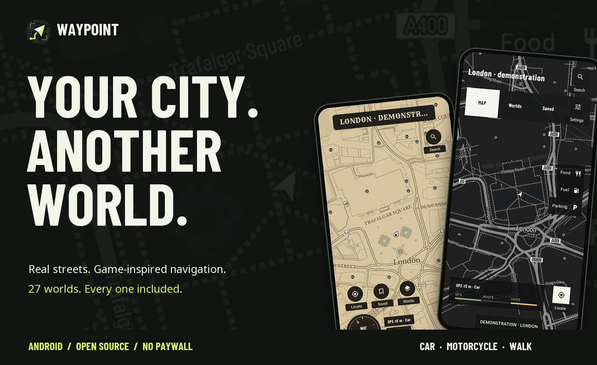
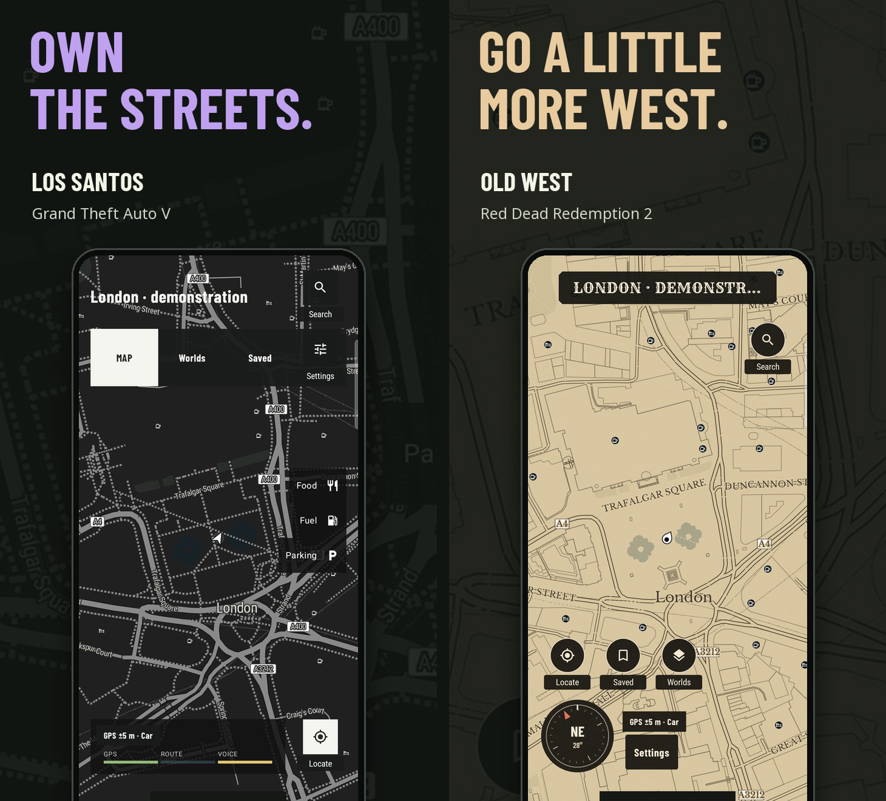
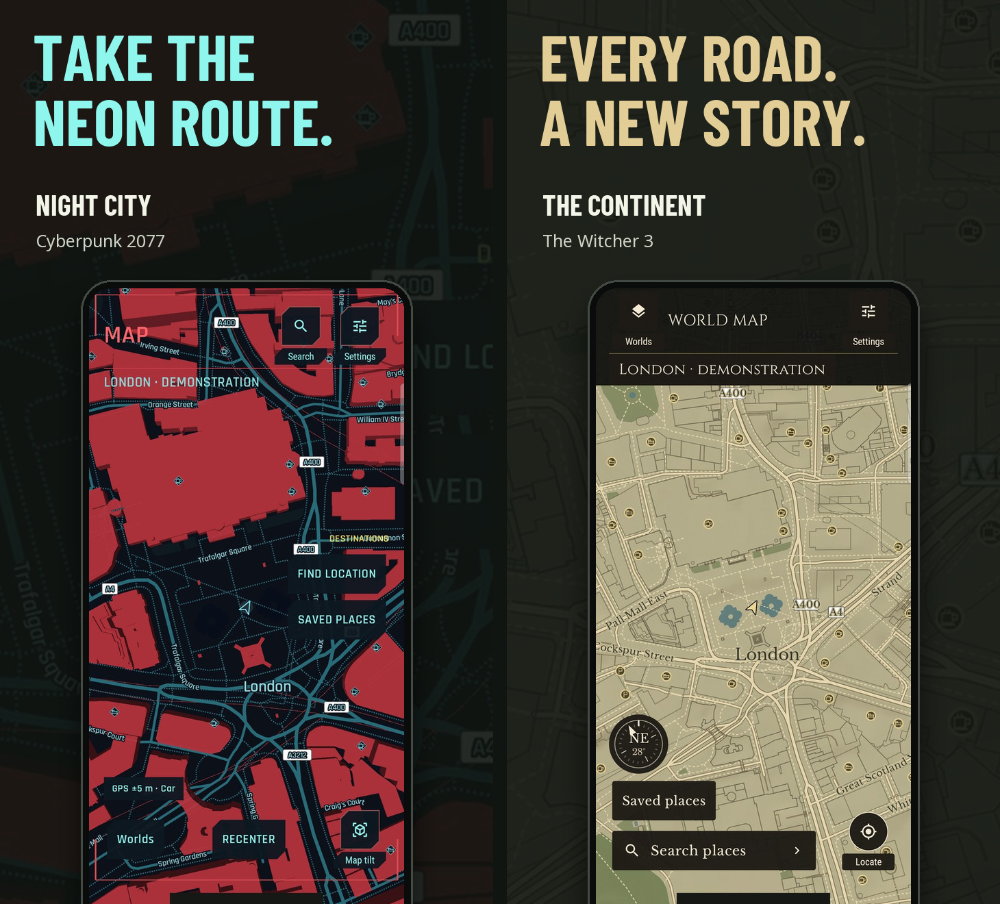
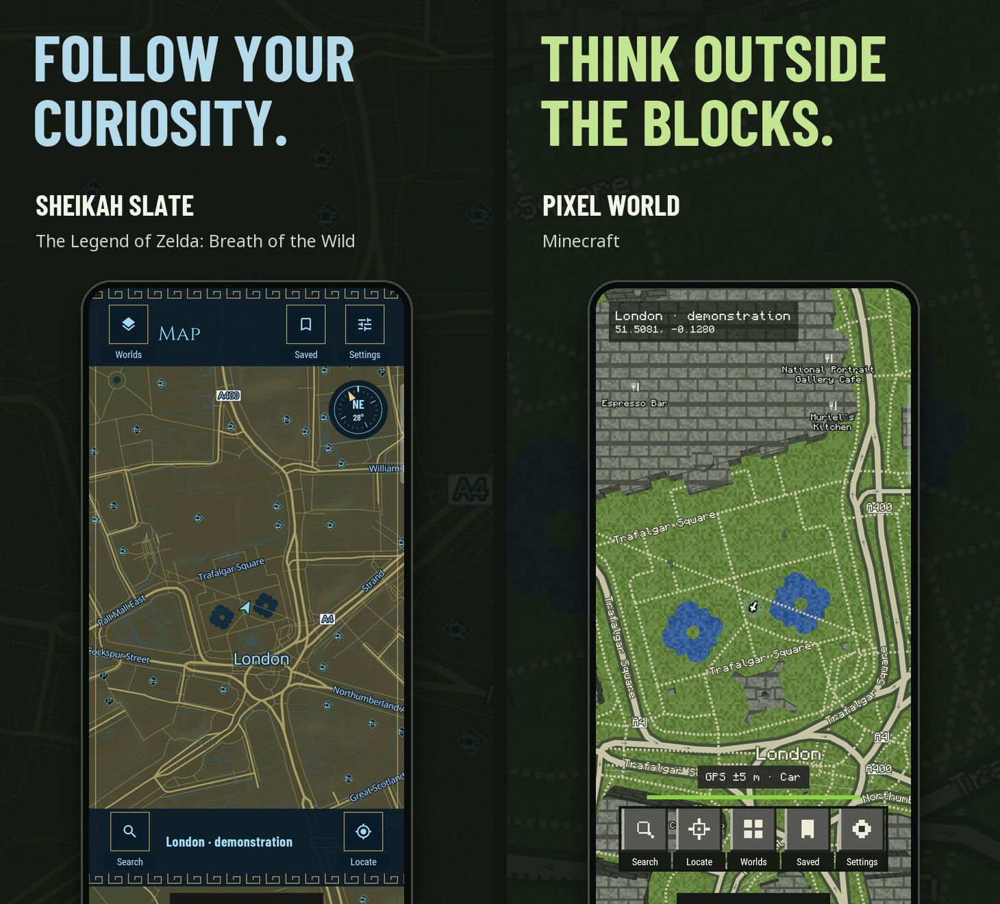
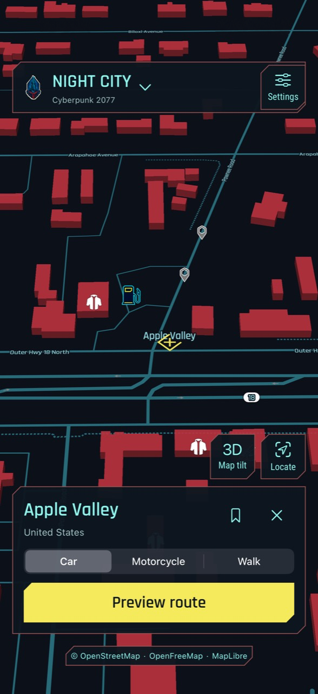
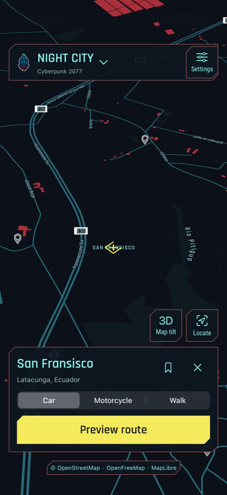
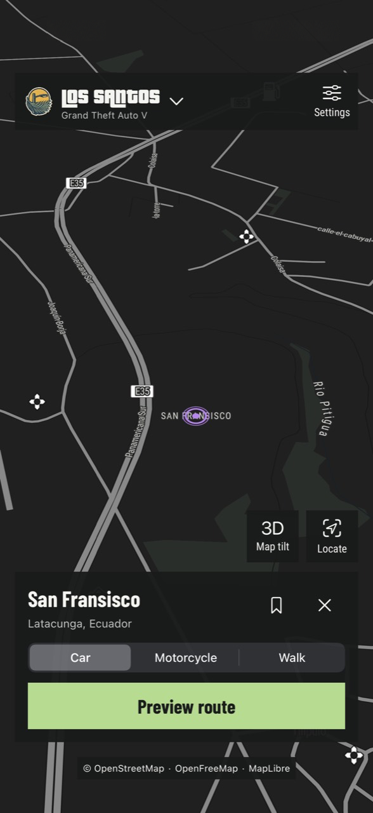

<div align="center">
  <picture>
    <source media="(max-width: 640px)" srcset="docs/images/promo/hero-mobile.jpg" />
    
  </picture>
  <h1>Real streets. Another world.</h1>
  <p>38 game-inspired maps, personal quests and spoken directions<br />on your phone and Android Auto.</p>
  <p>
    <a href="https://github.com/the-geeky-couldron/waypoint/releases/latest"></a>
    <a href="https://github.com/the-geeky-couldron/waypoint/releases"></a>
    <a href="https://github.com/the-geeky-couldron/waypoint/stargazers"></a>
    <a href="https://upstar.dev/r/the-geeky-couldron/waypoint" title="Upstar ranks the fastest-rising GitHub projects by topic. Rank as of November 6, 2026."></a>
  </p>
  <p><a href="https://github.com/the-geeky-couldron/waypoint/releases/latest"></a></p>
  <p><strong>Android 8.0+</strong> · No ads or paywall · No Waypoint account<br />Every world included · Made in India, open to the world</p>
  <p><a href="https://upstar.dev/r/the-geeky-couldron/waypoint"></a></p>
  <p><a href="https://repolode.com/en/repo/the-geeky-couldron/waypoint"></a></p>
</div>

<p align="center">
  <a href="#your-map-your-world">Explore the worlds</a> ·
  <a href="#your-world-on-the-dashboard">Android Auto</a> ·
  <a href="#ios-port-work-in-progress">iOS port</a> ·
  <a href="#get-waypoint">Install</a> ·
  <a href="#build-from-source">Build</a> ·
  <a href="#privacy-and-services">Privacy</a> ·
  <a href="#open-project">Guides</a>
</p>

---

## What's new in 2.0

- **Quests, right on the main bar:** add an everyday task, optional place, reminder or focus timer. Complete it to earn personal rewards.
- **Eleven new worlds:** nautical charts, tactical maps, an ASCII atlas, a 16-bit adventure, Exclusion Zone (S.T.A.L.K.E.R.) and Machine Atlas (NieR:Automata). Search, favourite and preview all 38 before applying one.
- **Bicycle navigation and saved names:** use a dedicated cycling route, and rename saved destinations to Work, Home or any name you recognise.
- **New-release alerts:** background checks are on by default. Android notification and battery-access explanations keep you in control of alerts and installation.
- **Easier map sharing:** share an address or supported Google Maps link into Waypoint, or open a destination in another map app.

🎮 Built with ideas from **@Balzamus**, **@matvejsyrygin256-dotcom**, **@6HentaiMaster9**, **@artmartins28** and **@VoidKittyKat**. Find the individual shout-outs and requests in the release notes.

[Full release notes →](docs/releases/current.md)

### Coming next: more routes, on the phone and in the car

- **Choose your route.** Previews show other ways to your destination as quieter lines on the map, each labelled with how many minutes it adds or saves. Tap one to take it.
- **Switch while you drive.** Waypoint keeps looking for fresh alternatives during guidance and offers them on the map. Pick one and guidance restarts from where you are.
- **Same choices in Android Auto.** The car preview frames every route on offer and has a **Routes** button. During guidance an **Other routes** button lists each alternative with its time difference. Selecting one switches your phone and car together.
- **A map key for every world.** Open the key to see that world's own place symbols, in its day or night palette.

## Your tasks, with rewards

Tap **Quests** beside Map, Worlds and Saved, then **Add a quest**. A title is all you need. Add a note, saved place, reminder, focus timer or character picture whenever it helps. Complete tasks yourself, with Undo if you tap by mistake.

A completed quest earns 20 XP; a finished focus session of at least ten minutes adds 10 XP once per quest. Your level, badges, avatar frames and short story chapters carry across every world. All navigation and worlds stay available from the beginning, and you can hide progression in **Your journey**.

Quests and pictures stay privately on your phone. Updates preserve them; uninstalling removes them. No account, subscription, cloud sync or theme-pack installation is needed. [Quest guide →](docs/quests.md)

## Your map, your world

Pick a world during onboarding, then explore real geography through its roads, typography, markers and navigation controls. Switch styles without losing your destination. The globe, world gallery and map are designed as one journey; the map itself remains readable while you travel.

After the first run, Waypoint opens your last selected world. Thanks to [u/cuberisk](https://www.reddit.com/user/cuberisk/) for suggesting that faster return to the map.

**Drawn for Waypoint:** all 38 worlds use map styles authored from scratch for this project, with their own road treatments, labels, textures, place symbols and destination markers. Day and night variants give the same place a different atmosphere. MapLibre renders the live geography; the app does not use MapLibre's sample styles or presets. [How the artwork is made →](docs/game-artwork-sources.md)

<picture>
  <source media="(max-width: 640px)" srcset="docs/images/promo/worlds-1-mobile.jpg" />
  
</picture>

<details>
<summary><strong>Explore Night City, The Continent, Sheikah Slate and Pixel World</strong></summary>

<picture>
  <source media="(max-width: 640px)" srcset="docs/images/promo/worlds-2-mobile.jpg" />
  
</picture>

<picture>
  <source media="(max-width: 640px)" srcset="docs/images/promo/worlds-3-mobile.jpg" />
  
</picture>

</details>

<p><sub>These compositions use sanitised native map captures at a fixed public London demonstration position. <a href="docs/images/promo/README.md">Artwork notes</a>.</sub></p>

<details>
<summary><strong>See all 38 worlds</strong></summary>

| World | Inspiration |
| --- | --- |
| Los Santos | Grand Theft Auto V |
| Old West | Red Dead Redemption 2 |
| Night City | Cyberpunk 2077 |
| Pixel World | Minecraft |
| Green Terminal | Fallout |
| San Andreas | Grand Theft Auto: San Andreas |
| Midnight Run | Need for Speed Heat |
| The Continent | The Witcher 3 |
| Vice Coast | Grand Theft Auto: Vice City |
| Liberty City | Grand Theft Auto IV |
| Nudle Maps | Watch Dogs 2 |
| Sheikah Slate | The Legend of Zelda: Breath of the Wild |
| Skyrim | The Elder Scrolls V: Skyrim |
| Lands Between | Elden Ring |
| Horizon | Forza Horizon |
| Animus | Assassin’s Creed Origins |
| Hope County | Far Cry 5 |
| Tsushima | Ghost of Tsushima |
| Bridges | Death Stranding |
| The Embrace | Horizon Zero Dawn |
| Manhattan | Marvel’s Spider-Man |
| Highlands | Hogwarts Legacy |
| Surface Map | Starfield |
| Bohemia | Kingdom Come: Deliverance II |
| Steelport | Saints Row: The Third |
| Medici | Just Cause 3 |
| Lost Heaven | Mafia: Definitive Edition |
| Dark Zone | The Division |
| Sea Chart | Sea of Thieves |
| DOS Atlas | DOS / ASCII interfaces |
| Aincrad | Sword Art Online |
| Tactical Radar | Counter-Strike |
| Vector Command | DEFCON |
| Field Ops | Call of Duty |
| 16-bit Quest | Retro console adventures |
| Home Console | Wii U / console menus |
| Exclusion Zone | S.T.A.L.K.E.R.: Shadow of Chernobyl |
| Machine Atlas | NieR:Automata |

</details>

## Your world, on the dashboard

With a supported installation, connect your phone and open Waypoint from the car launcher. The projected map follows the world selected on your phone, with a full route line, turn cues and a camera that follows travel. Search or pick a saved destination on the car screen; shared destinations ask before Waypoint previews a route.

**Launcher availability:** a GitHub-sideloaded APK may not appear in a real car’s launcher. Android requires a trusted distribution channel for Car App Library apps; its “Unknown sources” option does not cover Waypoint. [Android Auto setup and testing →](docs/guide.md#android-auto)

<picture>
  <source media="(max-width: 640px)" srcset="docs/images/promo/android-auto-mobile.jpg" />
  
</picture>

<p><sub>Captured in the Android Auto Desktop Head Unit with a fixed public London demonstration route. The route and guidance state were simulated for the screenshots; no personal location was used. <a href="docs/images/promo/README.md">Capture and artwork notes</a>.</sub></p>

The car preview shows other routes on the map with their time difference. **Routes** opens the list before you start, and **Other routes** appears during guidance when a different way is available; the same pick applies on the phone.

Android Auto keeps Google Maps available in the launcher. Open Waypoint there to use it as the current navigation app; installing it cannot change Android Auto's choice on its own. The car UI uses host-safe controls for search, saved destinations, voice, recenter and zoom. The phone remains the place to choose Car, Motorcycle, Bicycle or Walk.

## Built for the journey

- **Drive, cycle, ride or walk.** Choose a car, motorcycle, bicycle or walking route, then follow spoken turns, remaining distance and ETA.
- **Take the route into the car.** Android Auto shows Waypoint's selected world, moving map, route and next turn. Search, saved destinations, route choices and map controls stay within the car's template UI.
- **Keep your bearings.** Locate recentres on your actual position; the map follows movement and can recalculate after a confirmed wrong turn. A 2D/3D control changes the camera tilt.
- **Find useful places.** Search destinations, drop a pin, and see world-specific blips for food, pubs, shops, schools, hospitals and other mapped places. Icons appear progressively as you zoom so dense streets stay legible.
- **Pick up where you left off.** Save places, revisit recent destinations and switch worlds during a trip. Shared `geo:` and `google.navigation:` links ask for confirmation before Waypoint looks up or previews the imported destination.
- **Send feedback in context.** Settings opens a draft GitHub issue with the current world and app version. You review it in your browser before submitting; a GitHub account is needed to post the issue.


## iOS port (work in progress)

An iPhone/iPad port is being developed in [`ios/`](ios/README.md) for iOS 17 or later. The 0.3.0 branch follows Android 2.0.1 with 38 themed phone HUDs, Bicycle routing, saved-place renaming and local Quests. Android feature parity is still being checked, and the remaining device checks are listed in the validation record.

Progress and remaining work are tracked in [issue #12](https://github.com/the-geeky-couldron/waypoint/issues/12).

Unsigned [contribution preview builds](https://github.com/sanskarjaiswal2001/waypoint/releases) are available on the contributor's fork for installation through LiveContainer, SideStore or AltStore Classic. The app's update check and feedback form use the upstream repository; fork previews are separate downloads. Upstream iOS builds use the `ios-v*` release channel. Read the [feature comparison](ios/PARITY.md) and [iOS validation record](ios/VALIDATION.md) for known gaps and tests that have run. The promotional screenshots above show Android.

Navigation was reported working on an iPhone through LiveContainer with the 0.2.0 preview. These device screenshots show selected destinations in Night City and Los Santos; the 0.3.0 changes still need device verification:

<p align="center">
  
  
  
</p>

<p><sub>The captures show selected destinations, with no current-location view included. Status-bar items were removed without cropping, and metadata was stripped. <a href="docs/images/ios/README.md">Screenshot notes</a>.</sub></p>

## Get Waypoint

**[Download Waypoint.apk from GitHub Releases →](https://github.com/the-geeky-couldron/waypoint/releases/latest)**

1. Open the APK and follow Android’s installation prompts.
2. Complete onboarding, choose a world and open the map.
3. Tap **Locate** and grant precise location. Search for a destination or hold the map to drop a pin.
4. Choose **Car**, **Motorcycle**, **Bicycle** or **Walk**. Review the route, then tap **Start navigation**.

### Updating

Installed versions check for a newer stable GitHub release on foreground entry, at most once every 30 minutes; you can check manually in Settings at any time. If an update is available, an in-app prompt appears when the idle map is visible. Review the release notes, choose **Download update**, and confirm installation in Android.

The APK is checked against its checksum, package, version and installed signing identity. Waypoint shows What’s New once after a compatible update and keeps saved places and settings. This source tree is **Waypoint 2.5.0**; see the [release notes](docs/releases/current.md) and [changelog](CHANGELOG.md).

## Build from source

### iOS

The [iOS build guide](ios/README.md#build) covers Xcode/XcodeGen and the user-folder xtool setup used for the preview IPA. Build outputs and signing material stay outside Git.

### Android

You need **JDK 17**, Android **SDK Platform 36** and **Build Tools 35.0.0**. Set `ANDROID_HOME` or put your SDK path in the ignored `local.properties` file.

```sh
git clone https://github.com/the-geeky-couldron/waypoint.git
cd waypoint
./gradlew :app:assembleDebug :app:testDebugUnitTest :app:lintDebug
adb install -r app/build/outputs/apk/debug/app-debug.apk
```

The Android build uses Kotlin, Jetpack Compose and MapLibre Native. The checked-in app does not need a map API key or the optional artwork-generation tools.

Local release builds stay unsigned unless you supply distribution signing credentials; see the [release guide](docs/releasing.md).

For maintainers, the [development layout](docs/development/architecture.md) explains the source folders, asset generators and validation commands. The finished images in this README are kept in the repository; their working captures stay outside Git.

## Privacy and services

Waypoint has no app-owned account, analytics backend or recorded route history. Saved places, quests, pictures and personal progress stay on your device. Location and destinations are sent to providers when a map, search or route needs them. No live-traffic provider is configured, so Waypoint does not send location updates to a traffic service. The app’s update check contacts GitHub without location data.

| Feature | Service |
| --- | --- |
| Map tiles and labels | OpenFreeMap using OpenStreetMap data |
| Search and reverse geocoding | Photon; Android Geocoder when available |
| Car routes | OSRM |
| Motorcycle, bicycle and walking routes | Valhalla |
| Terrain | Mapzen |
| Google Maps link import and destination handoff | Google Maps, only when you choose either action |
| New-release checks | GitHub Releases, automatically in the background and when checking in Settings; no location data |
| Voice | Original AI-generated navigation cue packs for all 38 worlds; Android text-to-speech speaks unsupported or route-specific details when a safe recorded cue is unavailable |
| Guidance progress and rerouting | Ferrostar 0.59.0 using OSRM and Valhalla routes |
| Live traffic and traffic-adjusted ETA | Not configured; remaining ETA is based on the selected OSRM or Valhalla route through Ferrostar |

### Practical limits

The public map, search and routing endpoints require internet access and can be unavailable or rate-limited. Live traffic is not available in this build; Ferrostar remains authoritative for route progress, rerouting and remaining ETA using the selected routing response. Waypoint has no offline routing or lane guidance.

GPS and place coverage vary by device and location; real-road and long-duration testing are still needed. Read the [service and privacy guide](docs/guide.md#location-and-privacy) and [validation record](docs/validation.md) for the practical limits.

## Open project

| Guide | What it covers |
| --- | --- |
| [App guide](docs/guide.md) | Setup, navigation and service behavior |
| [Release guide](docs/releasing.md) | Signing, GitHub releases and updates |
| [Map typography](docs/map-fonts.md) | Fonts and map glyphs |
| [Visual sourcebook](docs/visual-sourcebook.md) | Cartography decisions and references |
| [Design system](DESIGN.md) | Colors, type, map treatments and interface rules |
| [Product notes](PRODUCT.md) | Scope and product behavior |
| [Development layout](docs/development/architecture.md) | Source structure, assets and checks |
| [Security review](docs/security.md) | Reviewed boundaries, source fixes and remaining validation |
| [Contributing](CONTRIBUTING.md) | Tests, public examples and repository hygiene |

### License and attribution

Waypoint is independent and is not affiliated with the games or their publishers. The **code is GPL-3.0-only**. The [third-party notices](THIRD_PARTY_NOTICES.md) cover components and data used by this project; [font licenses](docs/licenses/), [map icon notes](docs/poi-icon-sources.md) and [artwork notes](docs/game-artwork-sources.md) record the asset details. The original map-art claim above applies to Waypoint's cartography and map assets, not to retained interface and onboarding images.

Report security concerns through [SECURITY.md](SECURITY.md).

---

<div align="center">
  
  <p><strong>Every world included. Every journey your own.</strong></p>
  <p><a href="https://github.com/the-geeky-couldron/waypoint/releases/latest">Get Waypoint on GitHub →</a></p>
</div>
